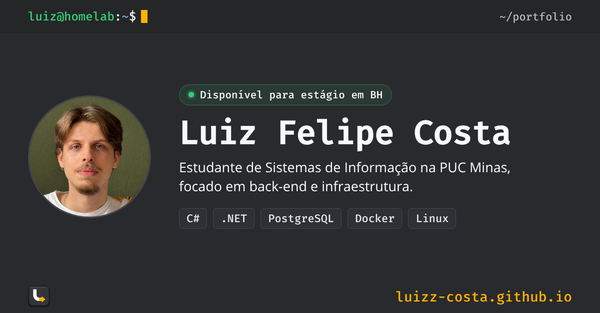
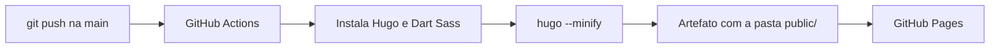

# luizz-costa.github.io

Meu portfólio pessoal: **[luizz-costa.github.io](https://luizz-costa.github.io)**



Site estático feito com [Hugo](https://gohugo.io) e o tema [Nightfall](https://github.com/LordMathis/hugo-theme-nightfall), publicado no GitHub Pages por um workflow do GitHub Actions. Não tem servidor nem banco de dados: o conteúdo fica em arquivos Markdown e YAML, e cada push na `main` gera e publica o site sozinho.

## Como o deploy funciona



O workflow fica em [`.github/workflows/hugo.yaml`](.github/workflows/hugo.yaml) e é baseado no [workflow oficial do Hugo](https://gohugo.io/host-and-deploy/host-on-github-pages/). As versões das ferramentas são fixadas no próprio arquivo, para que o site gerado no GitHub seja igual ao gerado localmente.

## Stack

- **Hugo 0.167.0 extended**: gera o HTML a partir do Markdown, dos dados em YAML e dos templates
- **Tema Nightfall**: incluído como submódulo Git, sem alterações nos arquivos dele
- **CSS e JavaScript próprios**: minificados e com fingerprint pelo Hugo
- **GitHub Actions + GitHub Pages**: build e hospedagem gratuitos

## Estrutura

```text
.
├── .github/workflows/hugo.yaml   # build e deploy
├── assets/
│   ├── css/portfolio.css         # estilos do portfólio, por cima do tema
│   └── js/menu.js                # menu do celular e seção ativa no cabeçalho
├── content/
│   ├── _index.md                 # texto da seção Sobre
│   └── projetos/                 # um arquivo por projeto
├── data/
│   ├── trajetoria.yaml           # linha do tempo
│   ├── tecnologias.yaml          # tecnologias por grupo
│   └── certificados.yaml         # cursos e certificações
├── layouts/
│   ├── home.html                 # página inicial
│   └── _partials/                # cabeçalho, metas de prévia e seções
├── static/                       # imagens, ícones, favicon e currículo
├── themes/hugo-theme-nightfall/  # tema (submódulo)
└── hugo.yaml                     # configuração do site
```

O tema não é editado. Tudo o que muda o visual está em `layouts/` e `assets/`, que o Hugo usa no lugar dos arquivos equivalentes do tema.

## Rodar localmente

Requisitos: [Hugo extended](https://gohugo.io/installation/) 0.167.0 ou mais novo e [Dart Sass](https://sass-lang.com/install/).

```bash
git clone --recurse-submodules https://github.com/luizz-costa/luizz-costa.github.io.git
cd luizz-costa.github.io
hugo server
```

O site abre em `http://localhost:1313` e recarrega a cada alteração salva.

Se o repositório foi clonado sem `--recurse-submodules`, o tema fica vazio. Para baixá-lo:

```bash
git submodule update --init --recursive
```

## Atualizar o conteúdo

| Para mudar | Edite |
|---|---|
| Nome, frase de apresentação, status e links | `params` em `hugo.yaml` |
| Texto do Sobre | `content/_index.md` |
| Projetos | `content/projetos/` (copie um arquivo existente; `weight` define a ordem) |
| Trajetória, tecnologias e certificados | arquivos em `data/` |
| Imagens de projetos e badges | `static/img/projetos/` e `static/badges/` |

Depois é só fazer commit e push na `main`. O deploy leva cerca de um minuto.

## Créditos

- Tema [Nightfall](https://github.com/LordMathis/hugo-theme-nightfall), de Matúš Námešný, licença MIT
- Ícones de tecnologias do [Devicon](https://devicon.dev), licença MIT ([`static/icones/LICENSE-devicon.txt`](static/icones/LICENSE-devicon.txt))
