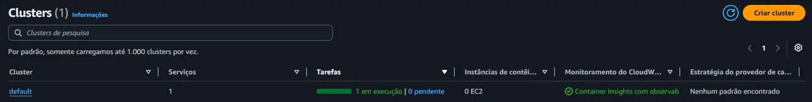

No dia 17 de outubro participei, online, do workshop de Amazon ECS do **AWS Student Builder Group PUC Minas**. Foi a minha primeira vez usando a AWS de verdade, com comandos e recursos rodando numa conta, e não só em slides.

O workshop tem quatro trilhas diferentes. Eu fiz uma delas, a **Introdução ao Amazon ECS Express Mode**. As outras três ficaram para outra oportunidade.

No dia do evento eu me perdi tentando acompanhar o ritmo ao vivo. Rodei os comandos, a aplicação subiu, mas eu não sabia direito o que tinha acontecido. Então, nos dois dias seguintes, enquanto a conta temporária do evento ainda estava no ar, apaguei o que tinha criado e refiz a trilha do zero, com calma, procurando entender cada passo antes de rodar.

Este texto conta o que eu fiz, o que deu errado e o que aprendi.

## Antes de tudo: o que é ECS e Fargate

Eu já uso containers no **Rodizio**, um sistema de escalas que desenvolvo em C# com PostgreSQL. Lá, o Docker Compose sobe a API e os bancos com um comando. E no servidor Linux que mantenho em casa, sou eu que cuido da máquina: sistema, atualizações, firewall. Foi comparando com isso que o ECS começou a fazer sentido para mim.

O **Amazon ECS** é um orquestrador de containers. Você diz "quero esta imagem rodando, com tanto de memória, nesta porta" e ele cuida de ligar, manter no ar e substituir o container se ele cair. É o papel que o `docker compose` faz no meu servidor, só que preparado para muitas máquinas.

O **AWS Fargate** é onde os containers rodam sem eu ter que cuidar de servidor nenhum. Os servidores existem, mas não são meus: eu não instalo sistema, não aplico atualização, não escolho máquina. Eu só digo quanto de CPU e memória cada container precisa e pago pelo tempo em que ele fica ligado.



| No ECS | O que é | No meu Rodizio |
|---|---|---|
| **Task definition** | A receita: imagem, CPU, memória, portas, variáveis | Um bloco de serviço no `docker-compose.yml` |
| **Task** | Um ou mais containers rodando a partir da receita | O container rodando |
| **Service** | Mantém um número de tasks sempre no ar | O `restart:` do Compose |
| **Cluster** | O agrupamento onde as tasks rodam | O meu servidor (aqui, sem máquina nenhuma minha) |
| **Amazon ECR** | O depósito de imagens | A imagem local que o `docker build` gera |

O **Express Mode** é uma forma simplificada de usar o ECS: com um comando, ele cria o serviço e tudo o que ele precisa em volta para ficar acessível na internet com segurança.

## O que eu fiz, parte por parte

### Limpar antes de começar

Antes de refazer, entrei no console da AWS para apagar o serviço que eu tinha criado no dia do evento. Na tela de exclusão, a AWS listou **14 recursos** ligados a ele: balanceador de carga, grupos de segurança (o firewall), certificado HTTPS, alarme, regras de escalabilidade e outros.

")

Eu tinha rodado **um comando** e ele tinha criado 14 coisas. Foi aí que entendi o que o Express Mode faz: ele monta sozinho a infraestrutura que, no meu servidor, eu teria que configurar peça por peça.

Ao apagar o serviço, 11 dos 14 recursos foram removidos. Sobraram 3 na lista: o cluster, o serviço (já inativo) e a definição da tarefa. A própria AWS avisou que os recursos compartilhados com outros serviços Express são mantidos. O cluster ficou vazio e não cobra nada, porque no Fargate a cobrança é pelas tasks rodando.

 e a definição da tarefa")

### Enviar um protótipo

A primeira parte da trilha coloca no ar só o site da loja de exemplo. Antes do comando, conferi as **roles do IAM** que o laboratório já tinha preparado. Role é como um crachá de permissões que um serviço "veste" para agir na conta, sem precisar de senha guardada em lugar nenhum. Eram três:

- uma para o Express Mode criar o balanceador, o firewall e a escalabilidade;
- uma para o ECS baixar a imagem e enviar os logs, antes de o container ligar;
- uma para o código da aplicação chamar outros serviços da AWS enquanto roda.

Depois rodei o comando de criação. Em poucos minutos a loja estava no ar com **HTTPS**, num endereço gerado pela própria AWS. A receita do container já estava na versão 5: as versões 1 a 4 eram do sábado, e a AWS continua a numeração mesmo depois de apagar o serviço.

### Trocar o tema, e o primeiro susto

O passo seguinte era trocar a cor do site para laranja, mudando uma variável de ambiente. O Express Mode faz isso com **canary deployment**: a versão nova recebe primeiro uma parte pequena do tráfego e, se estiver tudo bem, passa a receber tudo.

Na minha primeira tentativa, deu errado. O console mostrou que a implantação tinha sido revertida. Fui ler os eventos do serviço e encontrei a mensagem *"deployment failed: alarm detected"*. Um alarme do CloudWatch tinha disparado, e o ECS voltou sozinho para a versão anterior. A loja não saiu do ar em nenhum momento.

Eu achei que a causa fosse a porta do container e fui conferir antes de mudar qualquer coisa. Estava errado: a porta estava certa. Não cheguei a descobrir o que o alarme viu. Rodei a atualização de novo e, dessa vez, funcionou. Acessando a loja várias vezes seguidas pelo terminal, vi algumas respostas com o tema antigo e algumas com o novo; poucos minutos depois, só o novo.

### A loja completa

A segunda parte liga o site a quatro serviços de verdade: catálogo, carrinho, checkout e pedidos. Cada um é feito numa linguagem (Go, Java ou Node) e usa o seu próprio banco: MySQL, PostgreSQL, DynamoDB e Redis.

Esses quatro serviços ficam numa **rede privada**, sem acesso direto pela internet, atrás de um balanceador interno. Só o site conversa com eles. É a mesma ideia de quando eu publico as portas do Rodizio só em `127.0.0.1`: o banco e a API não ficam expostos para fora.

Outra coisa que me chamou atenção foi o jeito de passar as senhas dos bancos. O comando não leva a senha, só o endereço de onde ela está guardada (no **Secrets Manager**). O ECS busca o valor na hora de ligar o container e entrega como variável de ambiente. No Rodizio, eu uso os User Secrets do .NET para não deixar senha no código; aqui a ideia é a mesma.

Quando terminei, a página de topologia da loja mostrou os quatro serviços saudáveis. Coloquei um produto no carrinho, atualizei a página e ele continuou lá: agora estava salvo no DynamoDB, e não na memória.

### Lidar com o inesperado

A terceira parte simula um pico de tráfego e um deploy com defeito.

Primeiro configurei a escalabilidade do site: **mínimo de 2 tasks**, máximo de 10, e a meta de **50 requisições por task**. Depois usei uma ferramenta de teste de carga para mandar cerca de 10 requisições por segundo para a loja. Anotei os horários:

- 09h15: comecei a carga;
- 09h19: o alarme de "aumentar" disparou;
- 09h23: o serviço estava com **10 tasks rodando**, o máximo que eu tinha definido.

Saiu de 2 para 10 tasks em uns 8 minutos, sem eu rodar nenhum comando de escala. Depois parei a carga e devolvi o serviço para 2 tasks.

Em seguida veio o "erro de propósito": atualizar o site com a imagem do servidor web NGINX no lugar da loja. O NGINX não responde no endereço que o **health check** verifica, então a versão nova nunca ficou saudável. O ECS tentou, desistiu e voltou sozinho para a versão boa. Pelos eventos, levou cerca de 6 minutos, e a loja continuou no ar o tempo todo.

### Personalizar

Na última parte, confirmei pelo terminal que o **Container Insights** estava ligado no cluster, no modo aprimorado, e naveguei pelos gráficos e pelo mapa dos serviços no console do CloudWatch. Ele mostra CPU, memória e rede de cada container separado, e não só do serviço inteiro.
Depois adicionei um container ajudante, o **FireLens**, que roda junto com o site só para coletar e encaminhar os logs. O detalhe é que fiz isso "por fora" do Express Mode, com os comandos normais do ECS. No fim, a task do site estava rodando com três containers: o site, o FireLens e um agente de segurança que a própria AWS coloca. A última verificação da página, que confirma que o Express Mode mantém esse container depois de uma nova atualização, ficou de fora porque o ambiente estava para acabar.

## O que eu aprendi

**Auto scaling não é mágica, é uma meta.** Você escolhe uma métrica (CPU, memória ou requisições por task) e um valor, e o ECS adiciona ou remove tasks para chegar perto dele. Subir é rápido (o alarme olha 3 minutos) e descer é lento (15 minutos), de propósito: é melhor sobrar container por um tempo do que faltar e o site cair. O mínimo de 2 tasks é para continuar no ar se uma cair, e o máximo é um teto, inclusive de custo.

**Existem dois tipos de rollback automático, e eu vi os dois.** No primeiro, a versão nova liga, mas um alarme percebe erro no tráfego e manda voltar. No segundo, o *circuit breaker*, a versão nova nem consegue ficar saudável, e o ECS desiste depois de algumas tentativas. Nos dois casos, os usuários continuam na versão que funcionava.

**O health check é o que decide se uma versão presta.** É o mesmo conceito do `healthcheck` que eu uso no banco do Rodizio: um endereço que responde "estou bem". Se a aplicação muda e o health check não acompanha, como no caso do NGINX, o deploy nunca termina.

**O Container Insights olha dentro da task.** Com mais de um container na mesma task, como o site e o FireLens, ver o consumo de cada um separado faz diferença.

**Ler o erro antes de consertar.** Os eventos do serviço contam a história de trás para frente: a linha mais nova fica em cima, então leio de baixo para cima. E conferir a hipótese antes de mudar algo me impediu de "consertar" o que não estava quebrado.

## Erros e surpresas

- **Me perder ao vivo.** Seguir o palestrante e digitar ao mesmo tempo não funcionou para mim. Refazer com calma, entendendo cada comando, funcionou.
- **O rollback que eu não pedi.** O primeiro deploy do tema falhou por alarme e voltou sozinho. Foi o melhor exemplo de canary que eu poderia ter.
- **A hipótese errada.** Eu tinha certeza de que era a porta. Não era.
- **Terminal novo, variáveis perdidas.** Ao abrir outro terminal no dia seguinte, os endereços dos serviços guardados em variáveis tinham sumido, e tive que gerar de novo antes de continuar.
- **O comando que parecia travado.** O `aws ecs wait` fica parado de propósito até a implantação terminar, e pode levar minutos. Interromper com Ctrl+C só para a espera, não a implantação.
- **Horários em UTC.** Os horários da AWS vêm em UTC (o "Z" no fim). Para Brasília, são 3 horas a menos.

## O que eu ainda não sei

- Por que o alarme disparou na minha primeira troca de tema.
- Por que, durante o teste de carga, o meu comando de terminal mostrava o alarme como OK enquanto o console já mostrava "em alarme".
- Como montar tudo isso sem o Express Mode, peça por peça, e depois em Terraform.
- Quanto essa arquitetura custaria numa conta minha: só sei que balanceador, bancos e outros recursos cobram por hora, ligados ou não.
- As outras três trilhas do workshop, que falam de arquitetura em camadas, recursos avançados e rede.

## Para consultar depois

Uma cola rápida para quando eu estudar ECS e Fargate no curso de Cloud Foundations.

**Conceitos**

- **Cluster:** agrupamento lógico onde as tasks rodam. No Fargate, não tem máquina minha.
- **Task definition:** a receita (imagem, CPU, memória, portas, variáveis, roles). Cada mudança cria uma versão nova.
- **Task:** um ou mais containers rodando a partir da receita.
- **Service:** mantém N tasks no ar e as substitui se caírem.
- **Fargate × EC2:** no Fargate a AWS cuida das máquinas e eu pago pelo que a task usa enquanto roda; no EC2 eu cuido das máquinas e pago por elas mesmo ociosas.
- **Execution role × task role:** a primeira é do ECS, para preparar o container (baixar a imagem, buscar segredos, mandar logs); a segunda é do meu código, para chamar serviços da AWS enquanto roda.
- **Subnet pública × privada:** a pública fala com a internet; a privada, não. Serviços internos ficam na privada.
- **Balanceador compartilhado:** um balanceador só para vários serviços, separados pelo endereço que o usuário acessa (como o `server_name` do Nginx).
- **Canary:** a versão nova recebe uma parte pequena do tráfego antes de receber tudo.
- **Circuit breaker:** se a versão nova não fica saudável, o ECS volta para a anterior.
- **Target tracking:** escalar para manter uma métrica perto de uma meta.
- **Container Insights:** métricas por container no CloudWatch.
- **Sidecar:** um container ajudante na mesma task (por exemplo, para logs).

**Comandos de exemplo**

Criar um serviço com o Express Mode (os valores entre `< >` mudam para cada conta):

```bash
aws ecs create-express-gateway-service \
  --service-name meu-servico \
  --execution-role-arn arn:aws:iam::<ID_DA_CONTA>:role/<execution-role> \
  --infrastructure-role-arn arn:aws:iam::<ID_DA_CONTA>:role/<infrastructure-role> \
  --primary-container '{"image": "<imagem>:<versão>", "containerPort": 8080}' \
  --health-check-path "/health" \
  --network-configuration subnets=<subnet-1>,<subnet-2>
```

Ler os últimos eventos de um serviço (de baixo para cima):

```bash
aws ecs describe-services --cluster default --services meu-servico \
  --query "services[0].events[0:8].[createdAt,message]" --output text
```

Ver quantas tasks o serviço quer e quantas estão rodando:

```bash
aws ecs describe-services --cluster default --services meu-servico \
  --query 'services[0].{desejadas:desiredCount,rodando:runningCount}' --output table
```

Ver quais políticas gerenciadas estão anexadas a uma role:

```bash
aws iam list-attached-role-policies --role-name <nome-da-role>
```

## Para fechar

O que mais me marcou foi ver a AWS desfazer sozinha um deploy ruim, duas vezes, sem o site cair. No meu servidor, isso seria eu parando um container, subindo outro e torcendo para dar certo.

Agradeço ao AWS Student Builder Group PUC Minas pela organização e pela conta de laboratório. O próximo passo é continuar o curso AWS Academy Cloud Foundations, que vai cobrir com mais calma vários dos serviços que apareceram aqui, e mais adiante levar o Rodizio para a AWS.
